**Ingeniero de Sistemas · Full-Stack Developer · UX/UI · IA aplicada**

## 👋 Software que conecta personas, procesos y tecnología

Diseño y construyo **productos digitales de extremo a extremo**: desde las necesidades del usuario y el prototipo hasta el backend, las integraciones y el despliegue. Mi experiencia reúne sistemas empresariales, plataformas educativas, aplicaciones offline y soluciones de IA.

Trabajo con **React / Next.js, FastAPI / Laravel, PostgreSQL y Rust / Tauri**, combinando criterio de producto, interfaces claras e implementación técnica.

**01 · Experiencia de usuario** &nbsp; / &nbsp; **02 · Ingeniería full-stack** &nbsp; / &nbsp; **03 · Inteligencia artificial**

## 🚀 Productos y proyectos

<table>
<tr>
<td width="50%" valign="top">

### 🎓 AgendIA · Luvi
**Educación + experiencia móvil + IA**

Diseño e implementación de flujos para estudiantes: aula, tareas y agenda, con una interfaz amigable e integración de Luvi.

[Explorar AgendIA ↗](https://agendianet.com/)

</td>
<td width="50%" valign="top">

### 🌐 DESCOSUR
**UX/UI + plataforma institucional**

Arquitectura de información, portal responsive, administración, buscador y biblioteca. Del requerimiento a la publicación y capacitación.

[Ver plataforma ↗](https://comunidaddepractica.descosur.org.pe/)

</td>
</tr>
<tr>
<td width="50%" valign="top">

### 🧩 TUISP
**Software empresarial + integraciones**

CRM, facturación, pagos, tickets y portal para clientes ISP. Next.js, FastAPI y PostgreSQL; integraciones con SUNAT, Meta y MikroTik.

**Frontend · Backend · Seguridad · Despliegue**

</td>
<td width="50%" valign="top">

### 🎮 Aulanauta
**Educación gamificada + offline-first**

Interfaces para niños, actividades interactivas y narración local. Despliegue en **7 instituciones de Inicial y 8 de Primaria**, con capacitación docente.

**React · Rust · Tauri · SQLite**

</td>
</tr>
</table>

### 🔬 IA aplicada e investigación

- **[Búsqueda académica semántica](https://github.com/dieguito55/recomendador-semantico-tesis):** integración de repositorios, embeddings, FAISS y extensión de navegador.
- **[OmniFace](https://github.com/dieguito55/omniface):** reconocimiento facial en tiempo real para asistencia, con backend y paneles operativos.
- **[FishWatch](https://github.com/dieguito55/fish):** detección visual con YOLO y procesamiento en tiempo real.
- **[Quishing](https://github.com/dieguito55/Quishing_paper):** Vision Transformers y fusión visual–léxica para detección de amenazas en QR.

<b>Más productos, colaboración e impacto social</b>

- **[IRF26 · SpinOut](https://irf.spinoutworld.org/):** UX/UI, desarrollo web, dashboard y Mercado Pago; coorganización tecnológica de un programa con **31 jóvenes de 10 regiones**.
- **[UGEL El Collao](https://www.ugelelcollao.edu.pe/):** portal WordPress a medida, identidad visual, arquitectura de información y autogestión.
- **[Comunitarios](https://github.com/dieguito55/comunitarios):** plataforma institucional, programas, indicadores de impacto y donaciones.
- **DermaApp:** proyecto académico de apoyo al triaje dermatológico asistido por IA, premiado en EPIS UNA-Puno 2025.

---

## 🛠️ Tecnologías y herramientas

### 🔤 Lenguajes
     

### 🌐 Frontend
    

Interfaces responsive · Componentes reutilizables · Dashboards · Quasar

### ⚙️ Backend y datos
     

APIs REST · WebSockets · JWT/RBAC · SQLAlchemy Async · Alembic

### 🤖 Inteligencia artificial
    

Embeddings · FAISS · Búsqueda semántica · YOLO · PLN · Evaluación de modelos

### 🎨 UX/UI y diseño
    

FigJam · Wireframes y prototipos · Maze · Google Forms · Zeroheight

### 🖥️ Desktop, DevOps y herramientas
     

Offline-first · Piper TTS · SQLite · CI/CD · VPS/cPanel · Documentación técnica

---

## 💼 Experiencia en contextos reales

**TUISP · DESCOSUR · UNAP · Gobierno Regional de Puno, vía consultoría externa · SpinOut · Comunitarios**

<b>Ver trayectoria y responsabilidades</b>

- **TUISP:** desarrollo full-stack para ISP, seguridad, APIs e integraciones con servicios externos.
- **DESCOSUR:** plataforma institucional desde requerimientos y UX/UI hasta despliegue y capacitación.
- **Universidad Nacional del Altiplano:** prácticas en backend e IA para SIIRET, integración de repositorios y búsqueda semántica.
- **Gobierno Regional de Puno, vía consultoría externa:** aplicaciones educativas offline y colaboración en módulos SIEES con Laravel, Vue y Quasar.
- **SpinOut y Comunitarios:** desarrollo web, diseño de experiencias y apoyo tecnológico a iniciativas de innovación e impacto social.
- **Promolíder:** prácticas full-stack en CRM, APIs, automatización y documentación de despliegues.
- **UGEL El Collao:** portal web, análisis de datos, infografías y maquetación del PEL 2025–2030.
- **Poder Judicial, ODANC Puno:** aplicación Laravel, soporte e infraestructura; **309 horas de voluntariado**.

## 🏆 Reconocimientos

🇵🇪 **Finalista regional — Huawei ICT Competition 2025**, Computing Track, representando al Perú.

🥇 **Primer lugar — EPIS UNA-Puno 2025**, con DermaApp · **COINSI 2025** · **Concurso de Proyectos Estudiantiles UNA-Puno 2024**.

🎖️ Reconocimientos de **FIMEES–UNAP** y **CIP CD Puno** por participación destacada y labor como ponente.

---

### 🤝 Construyamos algo útil

Me interesa colaborar en **productos digitales, sistemas empresariales e inteligencia artificial aplicada**.

[Hablemos en LinkedIn ↗](https://www.linkedin.com/in/juan-diego-canaza-paucara/)

Diseño con propósito · Ingeniería de extremo a extremo · Tecnología para contextos reales

